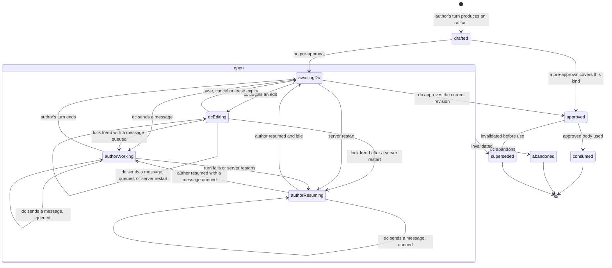
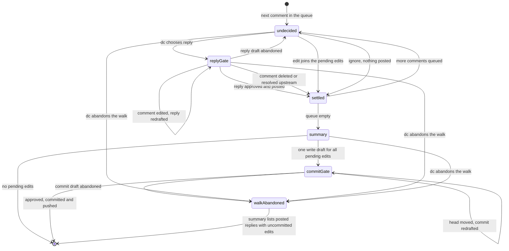

# 0004. Gate state machine

- Status: Accepted
- Date: 2026-11-26

## Context

The [interaction model](../design/1.4-interaction-model.md) makes a gate a conversation with the
agent that produced the artifact. It defines a gate's parts: the artifact with its `revision`, the
author's state, the edit lock, the conversation and the decision. It doesn't say which states those
parts combine into, which transitions are legal, or what invalidates an approval.

Job 1.8 (what modes permit at the gate, pinning approved writes, cold-resumable authors), the API
work under ADR 0003 and job 3.7's prototype all build on those answers. Session modes are
[ADR 0005](0005-session-permission-modes.md).

## Decision

- **One machine for every gate kind.** Design docs, code specs, implementation plans, job plans,
  write drafts and reply drafts run the same states. The kinds differ only in the table under Gate
  kinds.
- **`open` is derived.** The server stores the author's state (`working`, `idle`, `resuming`) and
  the lock holder (`none`, `author`, `dc`). The author holds the lock only while it is working.
  A lock held by dc is `dcEditing`, whatever the author's state. Otherwise, an idle author is
  `awaitingDc`, a working one `authorWorking` and a resuming one `authorResuming`.
- **Approve binds to one revision**, and for a write or reply draft also to the head or comment it
  was drafted against. Any change before the approval is used supersedes it.
- **dc's edit lock is a 5-minute lease**, renewed by the client every 30 s while edit mode is open.
- **A gate alerts once**, when it first enters `awaitingDc`.

### States

| State                 | Meaning                                                                                                                 |
| --------------------- | ----------------------------------------------------------------------------------------------------------------------- |
| `drafted`             | The author's turn produced the artifact. Resolves at once to `approved` under a pre-approval, otherwise to `awaitingDc` |
| `open.awaitingDc`     | Author idle, lock free. The only state where Approve is enabled                                                         |
| `open.authorWorking`  | The author is in a turn and holds the lock. dc's messages queue for its next turn                                       |
| `open.dcEditing`      | dc holds the lock as a lease, and his device shows the artifact as plain text                                           |
| `open.authorResuming` | The author's session is being cold-resumed (1.8). Approve is disabled                                                   |
| `approved`            | Bound to one revision, and to a head or comment where the kind has one. Waiting to be used                              |
| `consumed`            | Terminal. The approved body was used: the step moved on, the write ran or the reply posted                              |
| `abandoned`           | Terminal. dc abandoned the gate, with an optional reason that goes one level up                                         |
| `superseded`          | Terminal. What it decided on changed; a new gate replaces it                                                            |

### Transitions

| From                         | Trigger                                                        | Who                    | To               | dc sees                                                                                |
| ---------------------------- | -------------------------------------------------------------- | ---------------------- | ---------------- | -------------------------------------------------------------------------------------- |
| —                            | The author's turn produces an artifact                         | Author                 | `drafted`        | Nothing yet                                                                            |
| `drafted`                    | A pre-approval covers this kind                                | Server, on dc's policy | `approved`       | The gate settled in the record, never as a decision                                    |
| `drafted`                    | No pre-approval covers it                                      | Server                 | `awaitingDc`     | The item opens on the artifact, with Approve and Abandon enabled; one alert            |
| `awaitingDc`                 | `SendMessage`                                                  | dc                     | `authorWorking`  | His question in the conversation; the author working; Approve disabled                 |
| `authorWorking`              | `SendMessage`                                                  | dc                     | `authorWorking`  | His message queued for the author's next turn                                          |
| `authorWorking`              | The author's turn ends                                         | Author                 | `awaitingDc`     | The answer, and any edit animated: removals struck out, replacements typed in          |
| `awaitingDc`                 | `BeginEdit`                                                    | dc                     | `dcEditing`      | The artifact as plain text                                                             |
| `authorWorking`              | `BeginEdit`                                                    | dc                     | refused          | Edit disabled while the author is editing                                              |
| `authorResuming`             | `BeginEdit`                                                    | dc                     | refused          | Edit disabled while the author resumes                                                 |
| `dcEditing`                  | `BeginEdit`                                                    | dc                     | `dcEditing`      | Nothing changes; he is already editing                                                 |
| `dcEditing`                  | `SaveEdit(baseRevision)`                                       | dc                     | `awaitingDc`     | His text as the new revision; Approve enabled                                          |
| `dcEditing`                  | `CancelEdit`                                                   | dc                     | `awaitingDc`     | The artifact as it was                                                                 |
| `dcEditing`                  | The lease isn't renewed for 5 minutes                          | Server                 | `awaitingDc`     | His unsaved text, offered back                                                         |
| `dcEditing`                  | `SaveEdit`, `CancelEdit` or lease expiry with a message queued | dc or Server           | `authorWorking`  | The author's turn starting on his queued message, and any unsaved text offered back    |
| `dcEditing`                  | `SendMessage`                                                  | dc                     | `dcEditing`      | His message queued until the lock frees                                                |
| `dcEditing`                  | `edit_artifact`                                                | Author                 | refused (I1)     | Nothing; the author is told dc holds the lock                                          |
| `dcEditing`                  | The server restarts                                            | Server                 | `dcEditing`      | His edit continues; the lease survives, and the author is marked resuming              |
| `dcEditing`                  | `SaveEdit`, `CancelEdit` or lease expiry after a restart       | dc or Server           | `authorResuming` | His saved text, or his unsaved text offered back; the author shown as resuming         |
| any `open` state             | `SaveEdit` without the lock, after the lease expired           | dc                     | refused (I1)     | His text kept and offered back                                                         |
| `awaitingDc`                 | The server restarts                                            | Server                 | `authorResuming` | The author shown as resuming, not failed; Approve disabled                             |
| `authorWorking`              | The author's turn fails, or the server restarts                | Server                 | `authorResuming` | The author shown as resuming, not failed; Approve disabled                             |
| `authorResuming`             | `SendMessage`                                                  | dc                     | `authorResuming` | His message queued until the author is resumed                                         |
| `authorResuming`             | The author is resumed and idle                                 | Server                 | `awaitingDc`     | Approve enabled again                                                                  |
| `authorResuming`             | The author is resumed with a message queued                    | Server                 | `authorWorking`  | The author's turn starting on his queued message                                       |
| `awaitingDc`                 | `ApproveGate(revision)` at the current revision, with presence | dc                     | `approved`       | The gate settled; the item moves to its next decision                                  |
| `awaitingDc`                 | `ApproveGate` at a stale revision                              | dc                     | refused          | The newer text, with the change highlighted                                            |
| any `open` state             | `AbandonGate(reason)`                                          | dc                     | `abandoned`      | The author's turn stopped, any unsaved edit dropped, the reason sent one level up      |
| any `open` state, `approved` | Invalidated (below)                                            | Server or planner      | `superseded`     | A new gate whose original is the old one's latest body, so the diff shows what changed |
| `approved`                   | The approved body is used                                      | Server                 | `consumed`       | The gate settled in the record                                                         |

### Questions and edits

- **A question** is a `SendMessage`. It wakes the author. If the author only answers, the revision
  doesn't change, so dc can approve straight after. Messaging the author doesn't change its session
  mode ([ADR 0005](0005-session-permission-modes.md)).
- **An author edit** is an `edit_artifact` call during its turn. Each call bumps the revision and
  streams its hunks. Approve stays disabled until the turn ends.
- **dc's edit** takes the lock. Saving bumps the revision and records what changed for the author's
  next turn, without starting one, so dc can approve his own edit at once.

### What invalidates an approval

Before it is used, an approval is superseded, never carried over, when:

- The artifact gets a new revision by any route. For example, the plan round finds the approved
  spec wrong and its author revises it. The new gate's original is the approved body, so dc sees
  what changed since he approved.
- A write draft's PR head or base moves.
- A reply draft's comment is edited, deleted or resolved upstream.
- The planner replans or cancels the step that owns the gate.

The last three supersede an `open` gate too. Once a gate is `consumed`, a later change opens a new
gate rather than invalidating the old one.

### Gate kinds

| Kind                                       | Renders as                    | Abandon returns to                                        | Consumed when                            |
| ------------------------------------------ | ----------------------------- | --------------------------------------------------------- | ---------------------------------------- |
| Design doc, code spec, implementation plan | Markdown                      | The job's planner, which replans the step with the reason | The step's next round starts from it     |
| Job plan                                   | Markdown                      | The job's planner                                         | The engine starts the plan               |
| Write draft                                | Its exact payload             | The drafting session, which continues without the write   | The write runs; how it's pinned is 1.8's |
| Reply draft                                | The prose that will be posted | The comment walk, where the comment returns to undecided  | The reply posts from the outbox (1.8)    |

### The next decision

The server recomputes the item view on every transition. When a gate leaves `open`, `nextDecision`
and `focus` move to the item's next open gate, or to the next comment in a walk. With none left,
`focus` becomes `status` and the item's attention entry clears. Returning to `awaitingDc` after a
question or an edit doesn't alert again, and pre-approved and superseded gates never alert.

### Comment walk

A comment walk is a queue of one-comment positions, one open at a time. `replyGate` and
`commitGate` are gates running the machine above.

- A comment that arrives mid-walk joins the end of the queue.
- dc can abandon the walk at any open position, at a reply draft or at the summary. Abandoning the
  walk abandons any open reply draft with it.
- A superseded reply draft is redrafted when its comment was edited, and its position settles when
  the comment was deleted or resolved. A superseded commit draft is redrafted against the new head.
- Under the replies pre-approval, a reply posts unattended and its position shows as settled.
- dc sees the position (i of n), the comment with its author, body, `path:line` and diff slice, the
  author's thoughts and proposed disposition, the settled count, the pending-edit count and the
  uncommitted-reply warning.

## Alternatives

- **One machine per gate kind.** The kinds differ only in rendering, where Abandon returns to and
  what uses an approval. Six near-identical machines would drift apart.
- **An approval survives a small edit.** dc would approve one text and another would run, which
  breaks I2.
- **A "changes requested" state**, Outpost's decline-with-feedback. The conversation replaces it,
  and the interaction model already rejected it.
- **Separate `denied` and `declined` terminals.** They differ only in where the reason goes, which
  the Gate kinds table already says.

## Consequences

- The API models `Gate` with `authorState`, `lockHolder`, `revision`, a `decision` of `open`,
  `approved`, `consumed`, `abandoned` or `superseded`, and `supersededBy`.
- Job 1.8 owns pinning an approved write, the cold resume behind `authorResuming`, and which kinds
  may be pre-approved.
- Job 3.2 adds escape-corpus cases for `edit_artifact` aimed at another gate, an approval at a
  stale revision, and an `ApproveGate` replayed onto a superseded gate.
- Adding a state, or a gate kind with different Abandon semantics, needs an ADR that supersedes this
  one.

## Security

This touches T1 × B1, T2 × B1, T2 × B2, T2 × B3 and T3 × B1.

- **I1:** a lock conflict, a stale revision, an author error or an unknown command is refused or
  parks the gate. Only dc's approval or a pre-approval he set reaches `approved`; an author error
  lands in `authorResuming`.
- **I2:** an approval binds to one revision, and to a head or comment where the kind has one. Any
  change supersedes it, so nothing runs that dc didn't see.
- **I3:** messaging the author never widens its grants.
- **I4:** job 3.2 adds `edit_artifact` aimed at another gate to the escape corpus.
- **I5, I6:** the author can't approve, abandon, change pre-approvals or change its own mode, and
  its only tool reaches its own gate (I13).
- **I7:** an approved write runs with no credential beyond what its action declares.
- **I8, I9:** every gate command travels only over the authenticated, encrypted client channel.
- **I10:** gate commands from a revoked device are refused.
- **I11:** every Approve, Abandon and SaveEdit records the acting device. A replay onto a decided or
  superseded gate is refused.
- **I15:** `consumed` is terminal, so an approval is used at most once.
- **I16:** the artifact, the conversation and the author's thoughts render as inert text.

R1 and R2 stand. The threat model is unchanged.
