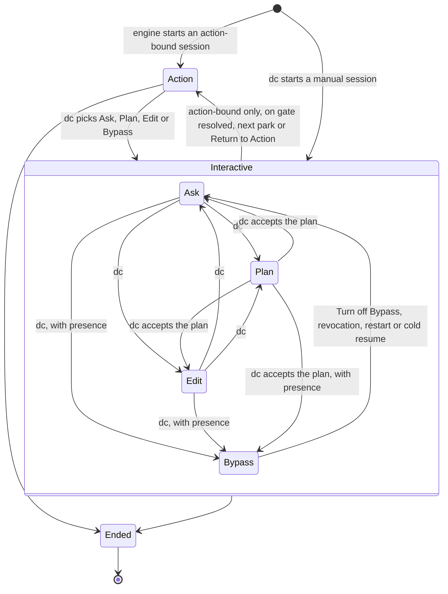

# 0005. Session permission modes

- Status: Accepted
- Date: 2026-11-26

## Context

The first draft of the [interaction model](../design/1.4-interaction-model.md) named three modes,
Action, Ask and Bypass, with Action non-interactive and switched to Ask by dc's first message. dc
wants to keep the interactive modes he already works in, Ask, Plan, Edit and Bypass, and to add
Action as the mode that action-bound sessions run in, on their action's own allowlist. Nobody
chooses Action by hand.

That splits sessions in two:

- **Action-bound:** the engine started it for an action, such as a planner, a controller, an
  action round or a dispatch.
- **Manual:** dc started it from a client.

Gates are [ADR 0004](0004-gate-state-machine.md).

## Decision

- **Five modes.** Ask, Plan, Edit and Bypass are interactive. Action is only for action-bound
  sessions and never appears in a manual session's mode menu. A session that ends is `Ended`, an
  end state rather than a mode.
- **Among the interactive modes, Plan is left only by Accept**, which dc uses to pick the next
  mode.
- **Messaging never changes a mode.** dc can talk to a session in any mode. Taking over an
  action-bound session is an explicit switch to an interactive mode.
- **An action-bound session returns to Action** when the gate it is answering resolves, at the
  step's next park, or when dc picks Return to Action.
- **Only dc enters Bypass**, per session, from a client, with presence on the device.
- **What each mode permits is 1.8's.** This ADR names the modes and what dc sees, and defines no
  grants.

### Modes

| Mode     | Who can be in it           | What dc sees                                                                                                                                                                                          |
| -------- | -------------------------- | ----------------------------------------------------------------------------------------------------------------------------------------------------------------------------------------------------- |
| `Action` | Action-bound sessions only | An `Action · <action name>` badge, the activity strip, the composer, and a mode menu offering Ask, Plan, Edit and Bypass                                                                              |
| `Ask`    | Any session                | An `Ask` badge and permission prompts inline in the conversation; Return to Action on an action-bound session                                                                                         |
| `Plan`   | Any session                | A `Plan` badge; the session's plan appears with Accept, which asks dc for the next mode; Return to Action on an action-bound session                                                                  |
| `Edit`   | Any session                | An `Edit` badge; edits in the session's checkout appear in the conversation as they happen, and any prompt shows inline; Return to Action on an action-bound session                                  |
| `Bypass` | Any session                | A persistent, high-contrast banner on the session, its item and its cockpit row, naming the device that turned it on and since when; Turn off Bypass, and Return to Action on an action-bound session |

When a session ends, its record shows `Ended` and the mode it ended in.

### Initial mode

- An action-bound session starts in Action.
- A manual session starts in the mode dc picks when he starts it: Ask by default, or Plan or Edit.
- No session starts in Bypass.

A manual session enters `Interactive` at the mode dc picked. The edge back to Action exists only
for action-bound sessions.

### Transitions

| From                               | Trigger                                             | Who    | To        | dc sees                                                        |
| ---------------------------------- | --------------------------------------------------- | ------ | --------- | -------------------------------------------------------------- |
| Any live mode                      | `SendMessage`                                       | dc     | Unchanged | His message; the badge doesn't change                          |
| Action                             | `SetMode(Ask \| Plan \| Edit)`                      | dc     | That mode | The new badge, and Return to Action                            |
| Ask, Edit                          | `SetMode(Ask \| Plan \| Edit)`                      | dc     | That mode | The new badge                                                  |
| Plan                               | `AcceptPlan(Ask \| Edit)`                           | dc     | That mode | The plan, then the new badge                                   |
| Plan                               | `SetMode`                                           | dc     | Refused   | Only Accept leaves Plan                                        |
| Action, Ask, Edit                  | `SetMode(Bypass)`, from a client, with presence     | dc     | Bypass    | The Bypass banner, with the device and the time                |
| Plan                               | `AcceptPlan(Bypass)`, from a client, with presence  | dc     | Bypass    | The plan, then the Bypass banner, with the device and the time |
| Bypass                             | `SetMode(Ask)`, labelled Turn off Bypass            | dc     | Ask       | The Ask badge                                                  |
| Bypass                             | `SetMode(Plan \| Edit)`                             | dc     | Refused   | Turn off Bypass first                                          |
| Any interactive mode, action-bound | The gate it is answering resolves                   | Server | Action    | The Action badge; a pending prompt shown as denied             |
| Any interactive mode, action-bound | The step's next park                                | Server | Action    | The Action badge; a pending prompt shown as denied             |
| Any interactive mode, action-bound | `ReturnToAction`                                    | dc     | Action    | The Action badge; a pending prompt shown as denied             |
| Any, manual                        | `SetMode(Action)`                                   | dc     | Refused   | Action isn't offered                                           |
| Bypass                             | The device that turned it on is revoked             | Server | Ask       | The Ask badge, and why Bypass ended                            |
| Bypass                             | The server restarts, or the session is cold-resumed | Server | Ask       | The Ask badge, and why Bypass ended                            |
| Any                                | `SetMode` from a planner, controller or agent       | —      | Refused   | Nothing changes; the refusal is in the session's record        |
| Any                                | The session ends                                    | Server | Ended     | The final mode in the record                                   |

Among the interactive modes, Plan is left only by Accept. On a return to Action, a permission
prompt still pending is denied, not carried into Action. A mode change applies from the session's
next tool call.

## Alternatives

- **Three modes, with Action switched to Ask by the first message.** This was the interaction
  model's version. It drops Plan and Edit, which dc uses, and makes every question at a gate a mode
  change.
- **Messaging an Action session switches it to Ask.** An author answering a question at its gate
  would leave its action's allowlist for a prompting mode it doesn't need.
- **Action selectable in a manual session.** A manual session has no action whose allowlist it
  could run on.
- **Keep Outpost's Drive and Hand back beside the modes.** Two overlapping concepts leave it unclear
  what a session may do; the interaction model already folded take-over into the modes.
- **Bypass survives a restart or a revocation.** A stale Bypass with nobody watching is what I5
  rules out.

## Consequences

- `Session` carries `mode`, `boundAction` (empty for a manual session), and `bypassDevice` and
  `bypassSince` while in Bypass.
- Outpost's Drive becomes picking an interactive mode on an action-bound session, and Hand back
  becomes Return to Action.
- Job 1.8 defines what each mode permits, how Ask prompts work, and whether an action-bound session
  in an interactive mode keeps its action's allowlist as a floor.
- Job 1.7's revocation has to reach this machine, for the revoked-device transition.
- Adding a mode, making Action selectable by hand, or any automatic path into Bypass needs an ADR
  that supersedes this one.

## Security

This touches T1 × B1, T1 × B2, T2 × B2 and T2 × B3. T5 × B2 doesn't apply: one person per server.

- **I5:** only dc, from a client, with presence, enters Bypass, and no automatic transition does.
  It clears on Turn off Bypass, on a return to Action, on a restart or cold resume, on revocation
  and when the session ends, and it is shown plainly.
- **I1:** a pending prompt is denied on a return to Action. An agent's `SetMode` and a manual
  session's `SetMode(Action)` are refused.
- **I2 (T2 × B3):** a mode never changes what an approved write runs.
- **I3, I6:** messaging never changes a mode or widens a grant. Action runs only on the action's
  declared allowlist. No agent changes a mode, and a session in Plan can't leave it by itself.
- **I10, I11 (T1 × B1, T1 × B2):** every `SetMode`, `AcceptPlan` and `ReturnToAction` is a client
  command that records the acting device, and Bypass drops when its device is revoked.
- **I4, I7, I13, I15:** unchanged by modes. R1 and R2 stand.

The threat model is unchanged: I5 already says only the session's owning user, from a client,
turns Bypass on.
